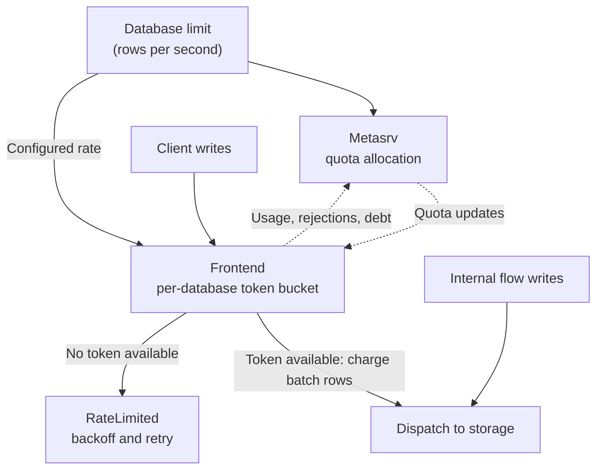

# Ingestion Rate Limit

GreptimeDB Enterprise supports limiting ingestion by rows per second for each
database. The limit is shared across all tables in the database, and each
database can have its own limit. This feature works in both standalone and
distributed deployments.

## How the limit is enforced

The limiter has two responsibilities: deciding whether to admit a batch locally,
and sharing a database's row budget across frontends in distributed mode. Local
token buckets make admission decisions; Metasrv redistributes quotas using
heartbeat feedback.

Client writes consume row quota during admission, before storage writes are
dispatched. Rows generated by ingestion protocol conversion count toward the
target database's quota. Internal writes generated by flows are exempt.

The following diagram shows a distributed deployment. The same feedback loop
applies to each frontend and database. Dashed arrows represent heartbeat messages:



### Bursts and large batches

Each frontend or standalone instance uses a token bucket whose capacity equals
one second of its effective row quota. Capacity refills as time passes.

A batch can be admitted when at least one whole row token is available, even if
the batch exceeds the remaining capacity. The excess becomes debt that is repaid
by future refills. Further writes are rejected until enough capacity is available
again. This allows batches larger than the quota to make progress, but a large
batch can cause a longer period of rejected writes afterward.

For example, with a fixed quota of 1,000 rows per second, a full bucket can admit
a 3,000-row batch and incur a 2,000-row debt. Subsequent writes are rejected until
the debt is repaid and at least one new token is available.

Admission consumes quota even if the write later fails during storage processing.
Disabling and re-enabling the limit does not reset outstanding debt.

### Standalone and distributed deployments

In standalone mode, the node enforces the configured database rate directly.

In distributed mode, Metasrv allocates per-database quotas to frontends based on
their reported ingestion demand and redistributes spare capacity. Frontends
receive quota updates through heartbeats and enforce their assigned quotas
locally, capped by the configured database rate.

The configured rate is a target for the database across the cluster. It is not a
strict ceiling for every one-second interval:

- Bursts and large batches can temporarily exceed the rate.
- A frontend without an assigned quota uses the full configured rate locally,
  so the cluster can exceed the target before quotas converge.
- Each frontend's effective quota is at least one row per second. If the
  configured limit is smaller than the number of participating frontends, their
  combined quotas can exceed the configured limit.

## Configure a limit

Set the database option `ingest_rows_rate_limit` to a positive integer specifying
the target ingestion rate in rows per second. The value must fit in an unsigned
64-bit integer; unit suffixes such as `1000/s` are not accepted. By default, the
option is unset and ingestion is unlimited.

Create a database with a target rate of 10,000 rows per second using
[`CREATE DATABASE`](/reference/sql/create.md#create-database):

```sql
CREATE DATABASE logs WITH ('ingest_rows_rate_limit' = '10000');
```

Change the rate for an existing database using
[`ALTER DATABASE`](/reference/sql/alter.md#alter-database):

```sql
ALTER DATABASE logs SET 'ingest_rows_rate_limit' = '20000';
```

Changes do not require a server restart. In distributed mode, quota
redistribution also depends on subsequent heartbeat updates.

The option applies to the whole database and cannot be set on individual tables.
It is not inherited as a table option when new tables are created.

Inspect the configured value using
[`SHOW CREATE DATABASE`](/reference/sql/show.md#show-create-database):

```sql
SHOW CREATE DATABASE logs;
```

## Disable the limit

Remove the option to restore unlimited ingestion:

```sql
ALTER DATABASE logs UNSET 'ingest_rows_rate_limit';
```

Setting the value to `0` also disables the limit:

```sql
ALTER DATABASE logs SET 'ingest_rows_rate_limit' = '0';
```

## Handle rejected writes

When capacity is unavailable, the write is rejected with a retryable
`RateLimited` error (GreptimeDB status code `6001`). HTTP ingestion requests
return `429 Too Many Requests`; native gRPC requests return
`RESOURCE_EXHAUSTED`. The error message includes the database name, rejected row
count, current quota, and configured limit.

Retry with exponential backoff and jitter to allow capacity to refill. Smaller
batches reduce the debt created by a single large write and can shorten recovery
time. Avoid immediate retry loops.
