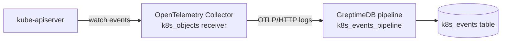

# Collect Kubernetes Events with OpenTelemetry Collector and GreptimeDB

This guide shows how to collect Kubernetes events with the OpenTelemetry Collector,
convert them into a structured table with a GreptimeDB pipeline,
and query them with SQL.

## Kubernetes Events

Kubernetes events record state changes and errors of cluster objects,
such as pod scheduling, image pulls, container restarts, failed probes, and scaling actions.
`kubectl get events` and `kubectl describe` show them.

By default, the kube-apiserver keeps events for one hour, as set by the `--event-ttl` flag.
In GreptimeDB, events are kept until the table's TTL expires, and you can query them with SQL.

## Architecture Overview



**Components:**

- **OpenTelemetry Collector**: Watches the `events.k8s.io/v1` API with the [`k8s_objects` receiver](https://github.com/open-telemetry/opentelemetry-collector-contrib/tree/main/receiver/k8sobjectsreceiver) and sends each event to GreptimeDB as an OTLP log record.
- **GreptimeDB pipeline**: Parses the event object in the log body and extracts the fields used for querying.
- **GreptimeDB**: Stores events in a table with indexes for filtering and full-text search.

:::note
Vector does not have a source for Kubernetes events.
Its `kubernetes_logs` source collects container logs only.
:::

## Prerequisites

- A running Kubernetes cluster
- `kubectl` configured to access your cluster
- [Helm](https://helm.sh/docs/intro/install/) v3.0.0 or higher installed
- A GreptimeDB cluster running in the Kubernetes cluster.
  See [Deploy GreptimeDB Cluster](/user-guide/deployments-administration/deploy-on-kubernetes/deploy-greptimedb-cluster.md).

This guide assumes the GreptimeDB cluster is named `greptimedb` and runs in the `greptime-cluster` namespace,
the same as in [Monitor Kubernetes Metrics with Prometheus and GreptimeDB](k8s-metrics-monitor.md).
The frontend service address inside the Kubernetes cluster is:

```text
greptimedb-frontend.greptime-cluster.svc.cluster.local:4000
```

If you use a different name or namespace, replace this address in every configuration in this guide.

The examples on this page are tested with Kubernetes v1.30.0 and the OpenTelemetry Collector Helm chart 0.178.3 (Collector v0.163.2).

## Create the Pipeline

The `k8s_objects` receiver puts the whole watch notification in the log body:
the watch type (`ADDED` or `MODIFIED`) and the complete Event object, including `managedFields`.
Without a pipeline, GreptimeDB stores the notification as a single JSON string in the `body` column.
The `k8s_events_pipeline` pipeline extracts the fields used for querying into separate columns.

Port-forward the HTTP port (`4000`) and the MySQL port (`4002`) of the GreptimeDB frontend to your local machine:

```bash
kubectl port-forward -n greptime-cluster svc/greptimedb-frontend 4000:4000 4002:4002
```

Create a file named `k8s_events_pipeline.yaml`:

```yaml
version: 2
processors:
  - vrl:
      source: |
        event = parse_json!(.Body)
        obj = object!(event.object)
        count = obj.series.count
        if is_null(count) { count = obj.deprecatedCount }
        if is_null(count) { count = 1 }
        . = {
          "timestamp": .ObservedTimestamp,
          "k8s_namespace": obj.metadata.namespace,
          "object_kind": obj.regarding.kind,
          "object_name": obj.regarding.name,
          "event_type": obj.type,
          "reason": obj.reason,
          "note": obj.note,
          "reporting_controller": obj.reportingController,
          "reporting_instance": obj.reportingInstance,
          "count": count,
          "event_uid": obj.metadata.uid
        }
        .

transform:
  - field: timestamp
    type: epoch, ns
    index: timestamp
  - fields:
      - k8s_namespace
      - object_kind
      - event_type
    type: string
    tag: true
  - field: object_name
    type: string
    index: skipping
  - field: reason
    type: string
    index: inverted
  - field: note
    type: string
    index: fulltext
  - fields:
      - reporting_controller
      - reporting_instance
      - event_uid
    type: string
  - field: count
    type: int64
```

The pipeline works as follows:

- `Body` and `ObservedTimestamp` are fields of the [pipeline input for OTLP logs](/user-guide/ingest-data/for-observability/opentelemetry.md#custom-pipeline-input). `Body` holds the watch notification as a JSON string.
- The [`vrl` processor](/reference/pipeline/pipeline-config.md#vrl) parses the body and replaces the pipeline context with the selected fields, so `managedFields` and other unused fields are not stored.
- `timestamp` is the time the collector received the notification. When an event repeats, Kubernetes updates the existing Event object, and the update arrives as a `MODIFIED` notification. Event recorders batch, aggregate, or rate-limit these updates, so one notification can cover several occurrences, and some occurrences produce no notification.
- `count` is the occurrence count stored in the Event object when the notification was sent. Events written through the `events.k8s.io/v1` API store it in `series.count`, and events written through the core `v1` API (for example, by kubelet) store it in `deprecatedCount`. If neither field is set, `count` is `1`. Because of the batching described for `timestamp`, the value can lag behind the actual number of occurrences.
- `k8s_namespace`, `object_kind`, and `event_type` are tags. Their cardinality is low.
- `object_name` has a skipping index, `reason` has an inverted index, and `note` has a full-text index.

Upload the pipeline:

```bash
curl -X POST "http://localhost:4000/v1/pipelines/k8s_events_pipeline" \
  -F "file=@k8s_events_pipeline.yaml"
```

```json
{"pipelines":[{"name":"k8s_events_pipeline","version":"2026-11-17 12:37:57.195976821"}],"execution_time_ms":1}
```

For more information about pipelines, see [Manage Pipelines](/user-guide/logs/manage-pipelines.md).

## Install the OpenTelemetry Collector

### Add the OpenTelemetry Helm Repository

```bash
helm repo add open-telemetry https://open-telemetry.github.io/opentelemetry-helm-charts
helm repo update
```

### Configure the Collector

Create an `otel-collector-values.yaml` file:

```yaml
mode: deployment
# Each replica watches all events. More than one replica writes duplicate rows.
replicaCount: 1

image:
  repository: otel/opentelemetry-collector-contrib

clusterRole:
  create: true
  rules:
    - apiGroups: ["events.k8s.io"]
      resources: ["events"]
      verbs: ["list", "watch"]

config:
  receivers:
    k8s_objects:
      objects:
        - name: events
          group: events.k8s.io
          mode: watch
          exclude_watch_type: [DELETED]
  exporters:
    otlp_http/greptimedb:
      endpoint: http://greptimedb-frontend.greptime-cluster.svc.cluster.local:4000/v1/otlp
      headers:
        x-greptime-log-table-name: k8s_events
        x-greptime-pipeline-name: k8s_events_pipeline
  service:
    pipelines:
      logs:
        receivers: [k8s_objects]
        exporters: [otlp_http/greptimedb]
      metrics: null
      traces: null
```

The configuration does the following:

- `mode: deployment` with `replicaCount: 1` runs a single collector for the whole cluster.
- `clusterRole` grants the collector permission to list and watch events in all namespaces.
- The `k8s_objects` receiver watches `events.k8s.io/v1` events. `exclude_watch_type: [DELETED]` drops the notifications sent when the kube-apiserver deletes expired events.
- The `otlp_http/greptimedb` exporter sends logs to the [GreptimeDB OTLP endpoint](/user-guide/ingest-data/for-observability/opentelemetry.md#logs). The `x-greptime-log-table-name` header sets the table name, and the `x-greptime-pipeline-name` header selects `k8s_events_pipeline`.
- `metrics: null` and `traces: null` remove the metrics and traces pipelines from the chart's default configuration.

The collector does not replay existing events when it starts.
Events created before the collector is installed, or while it is not running, are not collected.

If [authentication](/user-guide/deployments-administration/authentication/overview.md) is enabled in GreptimeDB,
add the `basicauth` extension to the exporter as shown in [OTel Collector](/user-guide/ingest-data/for-observability/otel-collector.md).

### Install the Collector

```bash
helm install otel-collector open-telemetry/opentelemetry-collector \
  --namespace monitoring \
  --create-namespace \
  --values otel-collector-values.yaml
```

Check that the collector is running:

```bash
kubectl get pods -n monitoring -l app.kubernetes.io/name=opentelemetry-collector
```

```bash
NAME                                                      READY   STATUS    RESTARTS   AGE
otel-collector-opentelemetry-collector-56d8864b4b-gm9gl   1/1     Running   0          2s
```

## Verify the Events in GreptimeDB

Create a deployment that references an image that does not exist.
Kubernetes emits `Warning` events when it fails to pull the image:

```bash
kubectl create deployment bad-image --image=nginx:does-not-exist
```

Connect to GreptimeDB with a MySQL client through the port-forward from [Create the Pipeline](#create-the-pipeline):

```bash
mysql -h 127.0.0.1 -P 4002
```

GreptimeDB creates the `k8s_events` table when the first event arrives:

```sql
SHOW CREATE TABLE k8s_events;
```

```sql
CREATE TABLE IF NOT EXISTS `k8s_events` (
  `timestamp` TIMESTAMP(9) NOT NULL,
  `k8s_namespace` STRING NULL,
  `object_kind` STRING NULL,
  `event_type` STRING NULL,
  `object_name` STRING NULL SKIPPING INDEX WITH(false_positive_rate = '0.01', granularity = '10240', type = 'BLOOM'),
  `reason` STRING NULL INVERTED INDEX,
  `note` STRING NULL FULLTEXT INDEX WITH(analyzer = 'English', backend = 'bloom', case_sensitive = 'false', false_positive_rate = '0.01', granularity = '10240'),
  `reporting_controller` STRING NULL,
  `reporting_instance` STRING NULL,
  `event_uid` STRING NULL,
  `count` BIGINT NULL,
  TIME INDEX (`timestamp`),
  PRIMARY KEY (`k8s_namespace`, `object_kind`, `event_type`)
)

ENGINE=mito
WITH(
  'comment' = 'Created on insertion',
  append_mode = 'true',
  'greptime.semantic.signal_type' = 'log',
  'greptime.semantic.source' = 'opentelemetry'
)
```

The table is created in append mode, so every notification is kept as a separate row.

## Query Events

List the latest warnings:

```sql
SELECT timestamp, k8s_namespace, object_kind, object_name, reason, note
FROM k8s_events
WHERE event_type = 'Warning'
ORDER BY timestamp DESC
LIMIT 5;
```

```sql
+----------------------------+---------------+-------------+---------------------------+--------+-------------------------------------------------------------+
| timestamp                  | k8s_namespace | object_kind | object_name               | reason | note                                                        |
+----------------------------+---------------+-------------+---------------------------+--------+-------------------------------------------------------------+
| 2026-11-17 12:38:56.564240 | default       | Pod         | bad-image-66c6f97bd-mtm6v | Failed | Error: ImagePullBackOff                                     |
| 2026-11-17 12:38:42.134856 | default       | Pod         | bad-image-66c6f97bd-mtm6v | Failed | Error: ErrImagePull                                         |
| 2026-11-17 12:38:42.132237 | default       | Pod         | bad-image-66c6f97bd-mtm6v | Failed | Failed to pull image "nginx:does-not-exist": rpc error: ... |
| 2026-11-17 12:38:28.576529 | default       | Pod         | bad-image-66c6f97bd-mtm6v | Failed | Error: ImagePullBackOff                                     |
| 2026-11-17 12:38:16.063063 | default       | Pod         | bad-image-66c6f97bd-mtm6v | Failed | Error: ErrImagePull                                         |
+----------------------------+---------------+-------------+---------------------------+--------+-------------------------------------------------------------+
```

Count `Warning` notifications by reason in the last hour.
Each row is one received notification, not one occurrence of the event:

```sql
SELECT reason, object_kind, count(*) AS notifications
FROM k8s_events
WHERE event_type = 'Warning'
  AND timestamp > now() - INTERVAL '1' HOUR
GROUP BY reason, object_kind
ORDER BY notifications DESC;
```

```sql
+--------+-------------+---------------+
| reason | object_kind | notifications |
+--------+-------------+---------------+
| Failed | Pod         |             9 |
+--------+-------------+---------------+
```

Count warnings per minute in each namespace:

```sql
SELECT date_bin(INTERVAL '1' MINUTE, timestamp) AS minute, k8s_namespace, count(*) AS notifications
FROM k8s_events
WHERE event_type = 'Warning'
GROUP BY minute, k8s_namespace
ORDER BY minute;
```

```sql
+---------------------+---------------+---------------+
| minute              | k8s_namespace | notifications |
+---------------------+---------------+---------------+
| 2026-11-17 12:38:00 | default       |             9 |
+---------------------+---------------+---------------+
```

Search event messages with [full-text search](/user-guide/logs/fulltext-search.md):

```sql
SELECT timestamp, object_name, note
FROM k8s_events
WHERE note @@ 'Back-off'
ORDER BY timestamp DESC
LIMIT 3;
```

```sql
+----------------------------+---------------------------+-----------------------------------------------+
| timestamp                  | object_name               | note                                          |
+----------------------------+---------------------------+-----------------------------------------------+
| 2026-11-17 12:38:56.561306 | bad-image-66c6f97bd-mtm6v | Back-off pulling image "nginx:does-not-exist" |
| 2026-11-17 12:38:28.569168 | bad-image-66c6f97bd-mtm6v | Back-off pulling image "nginx:does-not-exist" |
| 2026-11-17 12:38:01.133685 | bad-image-66c6f97bd-mtm6v | Back-off pulling image "nginx:does-not-exist" |
+----------------------------+---------------------------+-----------------------------------------------+
```

Show the event history of a pod.
Replace the pod name with one from your cluster:

```sql
SELECT timestamp, reason, count, note
FROM k8s_events
WHERE object_name = 'bad-image-66c6f97bd-mtm6v'
ORDER BY timestamp;
```

```sql
+----------------------------+-----------+-------+----------------------------------------------------------------------------------+
| timestamp                  | reason    | count | note                                                                             |
+----------------------------+-----------+-------+----------------------------------------------------------------------------------+
| 2026-11-17 12:37:59.239772 | Scheduled |     1 | Successfully assigned default/bad-image-66c6f97bd-mtm6v to k8s-tut-control-plane |
| 2026-11-17 12:37:59.618471 | Pulling   |     1 | Pulling image "nginx:does-not-exist"                                             |
| 2026-11-17 12:38:00.177770 | Failed    |     1 | Failed to pull image "nginx:does-not-exist": rpc error: ...                      |
| 2026-11-17 12:38:00.179947 | Failed    |     1 | Error: ErrImagePull                                                              |
| 2026-11-17 12:38:01.133685 | BackOff   |     1 | Back-off pulling image "nginx:does-not-exist"                                    |
| 2026-11-17 12:38:01.136782 | Failed    |     1 | Error: ImagePullBackOff                                                          |
| 2026-11-17 12:38:15.561016 | Pulling   |     2 | Pulling image "nginx:does-not-exist"                                             |
| 2026-11-17 12:38:16.059460 | Failed    |     2 | Failed to pull image "nginx:does-not-exist": rpc error: ...                      |
| 2026-11-17 12:38:16.063063 | Failed    |     2 | Error: ErrImagePull                                                              |
| 2026-11-17 12:38:28.569168 | BackOff   |     2 | Back-off pulling image "nginx:does-not-exist"                                    |
| ......                                                                                                                         |
+----------------------------+-----------+-------+----------------------------------------------------------------------------------+
```

## View Events in the GreptimeDB Dashboard

GreptimeDB includes a web dashboard with a Logs Query view.
With the port-forward from [Create the Pipeline](#create-the-pipeline) running, open [http://localhost:4000/dashboard](http://localhost:4000/dashboard),
select **Logs Query** in the sidebar, and select the `k8s_events` table.
The view shows the number of rows over time and the event rows in the selected time range.


## View Events in Grafana

The [GreptimeDB data source plugin](/user-guide/integrations/grafana.md#greptimedb-data-source-plugin) for Grafana provides a Logs query type,
which displays query results in Grafana's log view.

This section uses the Grafana installed by `kube-prometheus-stack` in
[Monitor Kubernetes Metrics with Prometheus and GreptimeDB](k8s-metrics-monitor.md#install-the-kube-prometheus-stack).
Update `kube-prometheus-values.yaml` to install the plugin and add a GreptimeDB data source:

```yaml
prometheus:
  prometheusSpec:
    remoteWrite:
      - url: http://greptimedb-frontend.greptime-cluster.svc.cluster.local:4000/v1/prometheus/write

grafana:
  sidecar:
    datasources:
      url: http://greptimedb-frontend.greptime-cluster.svc.cluster.local:4000/v1/prometheus
  # Install the GreptimeDB data source plugin, in the format <plugin ID>@<version>@<URL>
  plugins:
    - info8fcc-greptimedb-datasource@3.0.4@https://github.com/GreptimeTeam/greptimedb-grafana-datasource/releases/download/v3.0.4/info8fcc-greptimedb-datasource-unsigned.zip
  grafana.ini:
    plugins:
      allow_loading_unsigned_plugins: info8fcc-greptimedb-datasource
  additionalDataSources:
    - name: GreptimeDB
      type: info8fcc-greptimedb-datasource
      url: http://greptimedb-frontend.greptime-cluster.svc.cluster.local:4000
      jsonData:
        host: http://greptimedb-frontend.greptime-cluster.svc.cluster.local:4000
        database: public
        logs:
          defaultDatabase: public
          defaultTable: k8s_events
          timeColumn: timestamp
          messageColumn: note
          levelColumn: event_type
          selectContextColumns: true
          contextColumns:
            - k8s_namespace
            - object_kind
            - object_name
            - reason
```

The `logs` settings map the columns of the `k8s_events` table to the log view:
`note` is the log message, and `event_type` is the log level, so `Warning` events are shown as warnings.
The columns in `contextColumns` are added to each log query and shown as fields of each log line.

This configuration was tested with `kube-prometheus-stack` 93.3.1, which installs Grafana 13.3.1.

Upgrade the release:

```bash
helm upgrade kube-prometheus prometheus-community/kube-prometheus-stack \
  --namespace monitoring \
  --values kube-prometheus-values.yaml
```

Then [log in to Grafana](k8s-metrics-monitor.md#access-grafana) and query the events:

1. Open **Explore** and select the **GreptimeDB** data source.
2. Set **Query Type** to **Logs**. The builder fills in the `k8s_events` table and the time, message, and level columns from the data source settings.
3. In **Columns**, remove `trace_id`. The plugin adds a `trace_id` column to logs queries by default, and the `k8s_events` table does not have this column.
4. Click **Run query**.


## Clean Up

Remove the test deployment:

```bash
kubectl delete deployment bad-image
```

## Set Data Retention

The table keeps data forever by default.
Set a [TTL](/reference/sql/alter.md#alter-table-options) to delete old events automatically:

```sql
ALTER TABLE k8s_events SET 'ttl' = '30d';
```

## Next Steps

- Build Grafana dashboards with the [GreptimeDB data source plugin](/user-guide/integrations/grafana.md#greptimedb-data-source-plugin).
- Collect the metrics of the same cluster with [Monitor Kubernetes Metrics with Prometheus and GreptimeDB](k8s-metrics-monitor.md).
- Learn more about [pipeline configuration](/reference/pipeline/pipeline-config.md) and the [OpenTelemetry Collector integration](/user-guide/ingest-data/for-observability/otel-collector.md).
