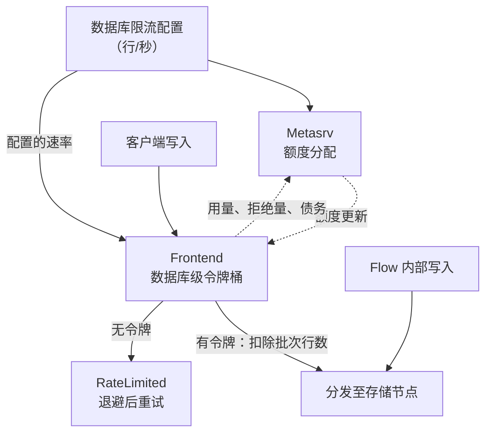

# 写入限流

GreptimeDB 企业版支持按数据库限制每秒写入的行数。同一数据库中的所有表共享
限流额度，每个数据库可以独立配置。该功能适用于单机和分布式部署。

## 限流机制

限流分为两部分：在本地决定是否接受一个写入批次，以及在分布式模式下将
数据库的行数额度分配给各个 Frontend。本地令牌桶负责写入准入，Metasrv
根据心跳反馈重新分配额度。

客户端写入在准入检查时消耗行数额度，此时尚未向存储节点分发写入请求。
写入协议转换后生成的行也计入目标数据库的额度。Flow 生成的内部写入不消耗
限流额度。

下图展示了分布式部署中的处理流程。每个 Frontend 上的每个数据库都遵循
相同的反馈机制，虚线箭头表示心跳消息：



### 突发写入和大批次

每个 Frontend 或单机实例使用令牌桶限流，桶容量等于该节点一秒的有效行数
额度。额度随时间补充。

只要桶内至少有一个完整的行令牌，就可以接受一个批次，即使该批次超过剩余
额度。超出的部分会形成债务，由后续补充的额度偿还。在重新获得足够额度
之前，后续写入会被拒绝。这使大于限流额度的批次仍能完成写入，但大批次可能
导致之后较长一段时间内的写入被拒绝。

例如，当额度固定为每秒 1,000 行时，一个满桶可以接受 3,000 行的批次，并产生
2,000 行的债务。在债务偿还完毕且至少补充一个新令牌之前，后续写入会被拒绝。

写入通过准入检查后，即使后续存储处理失败，已消耗的额度也不会退还。
关闭后重新开启限流不会清除尚未偿还的债务。

### 单机和分布式部署

单机模式直接按数据库配置的速率限流。

分布式模式由 Metasrv 根据各 Frontend 上报的写入需求，为它们分配数据库额度，
并重新分配空闲额度。Frontend 通过心跳接收更新，在本地执行分配到的额度，
且有效额度不超过数据库配置的速率。

配置的速率是整个集群中该数据库的目标写入速率，并非每个一秒窗口内的严格
上限：

- 突发写入和大批次可能暂时超过配置速率。
- 尚未收到分配额度的 Frontend 会在本地使用完整的数据库配置速率，因此在
  额度分配收敛前，集群总写入速率可能超过目标值。
- 每个 Frontend 的有效额度至少为每秒一行。如果配置值小于参与分配的
  Frontend 数量，各节点额度之和可能超过配置值。

## 配置限流

将数据库选项 `ingest_rows_rate_limit` 设置为正整数，以指定目标写入速率，单位为
行/秒。该值必须在无符号 64 位整数范围内，不接受 `1000/s` 等带单位的值。
默认不设置此选项，写入速率不受限制。

通过 [`CREATE DATABASE`](/reference/sql/create.md#create-database) 创建数据库，
将目标写入速率设置为每秒 10,000 行：

```sql
CREATE DATABASE logs WITH ('ingest_rows_rate_limit' = '10000');
```

通过 [`ALTER DATABASE`](/reference/sql/alter.md#alter-database) 修改已有数据库的
写入速率：

```sql
ALTER DATABASE logs SET 'ingest_rows_rate_limit' = '20000';
```

修改后无需重启服务。在分布式部署中，各 Frontend 的额度重新分配还取决于
后续的心跳更新。

该选项作用于整个数据库，不能在单个表上设置。创建新表时，它不会作为表选项
被继承。

通过 [`SHOW CREATE DATABASE`](/reference/sql/show.md#show-create-database)
查看已配置的值：

```sql
SHOW CREATE DATABASE logs;
```

## 关闭限流

移除该选项即可恢复不限速的写入：

```sql
ALTER DATABASE logs UNSET 'ingest_rows_rate_limit';
```

将值设置为 `0` 也可以关闭限流：

```sql
ALTER DATABASE logs SET 'ingest_rows_rate_limit' = '0';
```

## 处理被拒绝的写入

额度不足时，写入会返回可重试的 `RateLimited` 错误，GreptimeDB 状态码为
`6001`。HTTP 写入请求返回 `429 Too Many Requests`，原生 gRPC 请求返回
`RESOURCE_EXHAUSTED`。错误信息包含数据库名、被拒绝的行数、当前额度和
数据库配置的限流值。

重试时应使用带随机抖动的指数退避，为额度补充留出时间。减小批次可以减少
单次大批量写入产生的债务，并缩短恢复时间。避免立即连续重试。
