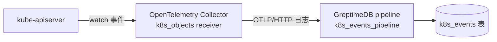

# 使用 OpenTelemetry Collector 和 GreptimeDB 采集 Kubernetes 事件

本指南介绍如何使用 OpenTelemetry Collector 采集 Kubernetes 事件，
通过 GreptimeDB Pipeline 将事件转换为结构化的表，
并使用 SQL 查询这些事件。

## Kubernetes 事件

Kubernetes 事件记录集群对象的状态变化和错误，
例如 Pod 调度、镜像拉取、容器重启、探针失败和扩缩容操作。
`kubectl get events` 和 `kubectl describe` 可以查看这些事件。

kube-apiserver 默认只保留一小时内的事件，保留时长由 `--event-ttl` 参数控制。
事件写入 GreptimeDB 后，保留时长由表的 TTL 决定，并且可以用 SQL 查询。

## 架构概览



**组件：**

- **OpenTelemetry Collector**：通过 [`k8s_objects` receiver](https://github.com/open-telemetry/opentelemetry-collector-contrib/tree/main/receiver/k8sobjectsreceiver) watch `events.k8s.io/v1` API，将每个事件作为一条 OTLP 日志发送给 GreptimeDB。
- **GreptimeDB Pipeline**：解析日志 body 中的事件对象，提取查询需要的字段。
- **GreptimeDB**：将事件存储在表中，并为过滤和全文搜索建立索引。

:::note
Vector 没有采集 Kubernetes 事件的 source，
它的 `kubernetes_logs` source 只采集容器日志。
:::

## 前提条件

- 一个运行中的 Kubernetes 集群
- 已配置 `kubectl` 以访问你的集群
- 已安装 [Helm](https://helm.sh/docs/intro/install/) v3.0.0 或更高版本
- 在 Kubernetes 集群中运行的 GreptimeDB 集群，
  部署方法请参考[部署 GreptimeDB 集群](/user-guide/deployments-administration/deploy-on-kubernetes/deploy-greptimedb-cluster.md)。

本指南假设 GreptimeDB 集群名为 `greptimedb`，部署在 `greptime-cluster` 命名空间，
与[使用 Prometheus 和 GreptimeDB 监控 Kubernetes 指标](k8s-metrics-monitor.md)一致。
Kubernetes 集群内的 frontend 服务地址为：

```text
greptimedb-frontend.greptime-cluster.svc.cluster.local:4000
```

如果使用了不同的名称或命名空间，请替换本指南所有配置中的这一地址。

本文示例在 Kubernetes v1.30.0 和 OpenTelemetry Collector Helm chart 0.178.3（Collector v0.163.2）上测试通过。

## 创建 Pipeline

`k8s_objects` receiver 会把完整的 watch 通知放进日志 body，
包括 watch 类型（`ADDED` 或 `MODIFIED`）和完整的 Event 对象，其中也包括 `managedFields`。
不使用 Pipeline 时，GreptimeDB 会把整条通知作为一个 JSON 字符串存入 `body` 列。
`k8s_events_pipeline` 会把查询需要的字段提取到单独的列中。

将 GreptimeDB frontend 的 HTTP 端口（`4000`）和 MySQL 端口（`4002`）转发到本地：

```bash
kubectl port-forward -n greptime-cluster svc/greptimedb-frontend 4000:4000 4002:4002
```

创建 `k8s_events_pipeline.yaml` 文件：

```yaml
version: 2
processors:
  - vrl:
      source: |
        event = parse_json!(.Body)
        obj = object!(event.object)
        count = obj.series.count
        if is_null(count) { count = obj.deprecatedCount }
        if is_null(count) { count = 1 }
        . = {
          "timestamp": .ObservedTimestamp,
          "k8s_namespace": obj.metadata.namespace,
          "object_kind": obj.regarding.kind,
          "object_name": obj.regarding.name,
          "event_type": obj.type,
          "reason": obj.reason,
          "note": obj.note,
          "reporting_controller": obj.reportingController,
          "reporting_instance": obj.reportingInstance,
          "count": count,
          "event_uid": obj.metadata.uid
        }
        .

transform:
  - field: timestamp
    type: epoch, ns
    index: timestamp
  - fields:
      - k8s_namespace
      - object_kind
      - event_type
    type: string
    tag: true
  - field: object_name
    type: string
    index: skipping
  - field: reason
    type: string
    index: inverted
  - field: note
    type: string
    index: fulltext
  - fields:
      - reporting_controller
      - reporting_instance
      - event_uid
    type: string
  - field: count
    type: int64
```

该 Pipeline 的处理逻辑如下：

- `Body` 和 `ObservedTimestamp` 是 [OTLP 日志 Pipeline 输入](/user-guide/ingest-data/for-observability/opentelemetry.md#自定义-pipeline-输入)中的字段，`Body` 是 JSON 字符串形式的 watch 通知。
- [`vrl` 处理器](/reference/pipeline/pipeline-config.md#vrl)解析 body，并用选出的字段替换整个 Pipeline 上下文，因此 `managedFields` 等不需要的字段不会被存储。
- `timestamp` 是 Collector 收到通知的时间。事件重复发生时，Kubernetes 会更新已有的 Event 对象，更新以 `MODIFIED` 通知的形式到达。事件记录器会对这些更新做批量写回、聚合或限流，因此一条通知可能对应多次发生，部分发生也可能没有对应的通知。
- `count` 是发送通知时 Event 对象中记录的发生次数。通过 `events.k8s.io/v1` API 写入的事件把次数记录在 `series.count` 中，通过核心 `v1` API 写入的事件（例如 kubelet 产生的事件）记录在 `deprecatedCount` 中。两个字段都没有时，`count` 为 `1`。由于上述批量写回，该值可能落后于实际发生次数。
- `k8s_namespace`、`object_kind` 和 `event_type` 是 tag，它们的基数较低。
- `object_name` 使用跳数索引，`reason` 使用倒排索引，`note` 使用全文索引。

上传 Pipeline：

```bash
curl -X POST "http://localhost:4000/v1/pipelines/k8s_events_pipeline" \
  -F "file=@k8s_events_pipeline.yaml"
```

```json
{"pipelines":[{"name":"k8s_events_pipeline","version":"2026-11-17 12:37:57.195976821"}],"execution_time_ms":1}
```

有关 Pipeline 的更多信息，请参考[管理 Pipeline](/user-guide/logs/manage-pipelines.md)。

## 安装 OpenTelemetry Collector

### 添加 OpenTelemetry Helm 仓库

```bash
helm repo add open-telemetry https://open-telemetry.github.io/opentelemetry-helm-charts
helm repo update
```

### 配置 Collector

创建 `otel-collector-values.yaml` 文件：

```yaml
mode: deployment
# 每个副本都会 watch 全部事件，多个副本会写入重复的数据。
replicaCount: 1

image:
  repository: otel/opentelemetry-collector-contrib

clusterRole:
  create: true
  rules:
    - apiGroups: ["events.k8s.io"]
      resources: ["events"]
      verbs: ["list", "watch"]

config:
  receivers:
    k8s_objects:
      objects:
        - name: events
          group: events.k8s.io
          mode: watch
          exclude_watch_type: [DELETED]
  exporters:
    otlp_http/greptimedb:
      endpoint: http://greptimedb-frontend.greptime-cluster.svc.cluster.local:4000/v1/otlp
      headers:
        x-greptime-log-table-name: k8s_events
        x-greptime-pipeline-name: k8s_events_pipeline
  service:
    pipelines:
      logs:
        receivers: [k8s_objects]
        exporters: [otlp_http/greptimedb]
      metrics: null
      traces: null
```

该配置的作用如下：

- `mode: deployment` 和 `replicaCount: 1` 让整个集群只运行一个 Collector。
- `clusterRole` 授予 Collector 在所有命名空间中 list 和 watch 事件的权限。
- `k8s_objects` receiver watch `events.k8s.io/v1` 事件。`exclude_watch_type: [DELETED]` 丢弃 kube-apiserver 删除过期事件时产生的通知。
- `otlp_http/greptimedb` exporter 将日志发送到 [GreptimeDB 的 OTLP 端点](/user-guide/ingest-data/for-observability/opentelemetry.md#logs)。`x-greptime-log-table-name` header 指定表名，`x-greptime-pipeline-name` header 指定 `k8s_events_pipeline`。
- `metrics: null` 和 `traces: null` 移除 chart 默认配置中的 metrics 和 traces pipeline。

Collector 启动时不会回放已有的事件。
安装 Collector 之前或 Collector 停止期间产生的事件不会被采集。

如果 GreptimeDB 启用了[鉴权](/user-guide/deployments-administration/authentication/overview.md)，
请参考 [OTel Collector](/user-guide/ingest-data/for-observability/otel-collector.md) 为 exporter 添加 `basicauth` 扩展。

### 安装 Collector

```bash
helm install otel-collector open-telemetry/opentelemetry-collector \
  --namespace monitoring \
  --create-namespace \
  --values otel-collector-values.yaml
```

检查 Collector 是否正常运行：

```bash
kubectl get pods -n monitoring -l app.kubernetes.io/name=opentelemetry-collector
```

```bash
NAME                                                      READY   STATUS    RESTARTS   AGE
otel-collector-opentelemetry-collector-56d8864b4b-gm9gl   1/1     Running   0          2s
```

## 在 GreptimeDB 中验证事件

创建一个引用不存在镜像的 Deployment，
Kubernetes 在拉取镜像失败时会产生 `Warning` 事件：

```bash
kubectl create deployment bad-image --image=nginx:does-not-exist
```

通过[创建 Pipeline](#创建-pipeline) 中的端口转发，使用 MySQL 客户端连接 GreptimeDB：

```bash
mysql -h 127.0.0.1 -P 4002
```

第一个事件到达时，GreptimeDB 会创建 `k8s_events` 表：

```sql
SHOW CREATE TABLE k8s_events;
```

```sql
CREATE TABLE IF NOT EXISTS `k8s_events` (
  `timestamp` TIMESTAMP(9) NOT NULL,
  `k8s_namespace` STRING NULL,
  `object_kind` STRING NULL,
  `event_type` STRING NULL,
  `object_name` STRING NULL SKIPPING INDEX WITH(false_positive_rate = '0.01', granularity = '10240', type = 'BLOOM'),
  `reason` STRING NULL INVERTED INDEX,
  `note` STRING NULL FULLTEXT INDEX WITH(analyzer = 'English', backend = 'bloom', case_sensitive = 'false', false_positive_rate = '0.01', granularity = '10240'),
  `reporting_controller` STRING NULL,
  `reporting_instance` STRING NULL,
  `event_uid` STRING NULL,
  `count` BIGINT NULL,
  TIME INDEX (`timestamp`),
  PRIMARY KEY (`k8s_namespace`, `object_kind`, `event_type`)
)

ENGINE=mito
WITH(
  'comment' = 'Created on insertion',
  append_mode = 'true',
  'greptime.semantic.signal_type' = 'log',
  'greptime.semantic.source' = 'opentelemetry'
)
```

该表以追加模式（append mode）创建，每条通知都会作为单独的一行保存。

## 查询事件

查询最近的 Warning 事件：

```sql
SELECT timestamp, k8s_namespace, object_kind, object_name, reason, note
FROM k8s_events
WHERE event_type = 'Warning'
ORDER BY timestamp DESC
LIMIT 5;
```

```sql
+----------------------------+---------------+-------------+---------------------------+--------+-------------------------------------------------------------+
| timestamp                  | k8s_namespace | object_kind | object_name               | reason | note                                                        |
+----------------------------+---------------+-------------+---------------------------+--------+-------------------------------------------------------------+
| 2026-11-17 12:38:56.564240 | default       | Pod         | bad-image-66c6f97bd-mtm6v | Failed | Error: ImagePullBackOff                                     |
| 2026-11-17 12:38:42.134856 | default       | Pod         | bad-image-66c6f97bd-mtm6v | Failed | Error: ErrImagePull                                         |
| 2026-11-17 12:38:42.132237 | default       | Pod         | bad-image-66c6f97bd-mtm6v | Failed | Failed to pull image "nginx:does-not-exist": rpc error: ... |
| 2026-11-17 12:38:28.576529 | default       | Pod         | bad-image-66c6f97bd-mtm6v | Failed | Error: ImagePullBackOff                                     |
| 2026-11-17 12:38:16.063063 | default       | Pod         | bad-image-66c6f97bd-mtm6v | Failed | Error: ErrImagePull                                         |
+----------------------------+---------------+-------------+---------------------------+--------+-------------------------------------------------------------+
```

统计最近一小时内各原因的 `Warning` 通知数量。
每一行对应收到的一条通知，而不是事件的一次发生：

```sql
SELECT reason, object_kind, count(*) AS notifications
FROM k8s_events
WHERE event_type = 'Warning'
  AND timestamp > now() - INTERVAL '1' HOUR
GROUP BY reason, object_kind
ORDER BY notifications DESC;
```

```sql
+--------+-------------+---------------+
| reason | object_kind | notifications |
+--------+-------------+---------------+
| Failed | Pod         |             9 |
+--------+-------------+---------------+
```

按分钟统计各命名空间的 `Warning` 通知数量：

```sql
SELECT date_bin(INTERVAL '1' MINUTE, timestamp) AS minute, k8s_namespace, count(*) AS notifications
FROM k8s_events
WHERE event_type = 'Warning'
GROUP BY minute, k8s_namespace
ORDER BY minute;
```

```sql
+---------------------+---------------+---------------+
| minute              | k8s_namespace | notifications |
+---------------------+---------------+---------------+
| 2026-11-17 12:38:00 | default       |             9 |
+---------------------+---------------+---------------+
```

使用[全文搜索](/user-guide/logs/fulltext-search.md)检索事件消息：

```sql
SELECT timestamp, object_name, note
FROM k8s_events
WHERE note @@ 'Back-off'
ORDER BY timestamp DESC
LIMIT 3;
```

```sql
+----------------------------+---------------------------+-----------------------------------------------+
| timestamp                  | object_name               | note                                          |
+----------------------------+---------------------------+-----------------------------------------------+
| 2026-11-17 12:38:56.561306 | bad-image-66c6f97bd-mtm6v | Back-off pulling image "nginx:does-not-exist" |
| 2026-11-17 12:38:28.569168 | bad-image-66c6f97bd-mtm6v | Back-off pulling image "nginx:does-not-exist" |
| 2026-11-17 12:38:01.133685 | bad-image-66c6f97bd-mtm6v | Back-off pulling image "nginx:does-not-exist" |
+----------------------------+---------------------------+-----------------------------------------------+
```

查看某个 Pod 的事件历史，将 Pod 名称替换为集群中实际的 Pod：

```sql
SELECT timestamp, reason, count, note
FROM k8s_events
WHERE object_name = 'bad-image-66c6f97bd-mtm6v'
ORDER BY timestamp;
```

```sql
+----------------------------+-----------+-------+----------------------------------------------------------------------------------+
| timestamp                  | reason    | count | note                                                                             |
+----------------------------+-----------+-------+----------------------------------------------------------------------------------+
| 2026-11-17 12:37:59.239772 | Scheduled |     1 | Successfully assigned default/bad-image-66c6f97bd-mtm6v to k8s-tut-control-plane |
| 2026-11-17 12:37:59.618471 | Pulling   |     1 | Pulling image "nginx:does-not-exist"                                             |
| 2026-11-17 12:38:00.177770 | Failed    |     1 | Failed to pull image "nginx:does-not-exist": rpc error: ...                      |
| 2026-11-17 12:38:00.179947 | Failed    |     1 | Error: ErrImagePull                                                              |
| 2026-11-17 12:38:01.133685 | BackOff   |     1 | Back-off pulling image "nginx:does-not-exist"                                    |
| 2026-11-17 12:38:01.136782 | Failed    |     1 | Error: ImagePullBackOff                                                          |
| 2026-11-17 12:38:15.561016 | Pulling   |     2 | Pulling image "nginx:does-not-exist"                                             |
| 2026-11-17 12:38:16.059460 | Failed    |     2 | Failed to pull image "nginx:does-not-exist": rpc error: ...                      |
| 2026-11-17 12:38:16.063063 | Failed    |     2 | Error: ErrImagePull                                                              |
| 2026-11-17 12:38:28.569168 | BackOff   |     2 | Back-off pulling image "nginx:does-not-exist"                                    |
| ......                                                                                                                         |
+----------------------------+-----------+-------+----------------------------------------------------------------------------------+
```

## 在 GreptimeDB Dashboard 中查看事件

GreptimeDB 自带的 Web Dashboard 提供 Logs Query 视图。
保持[创建 Pipeline](#创建-pipeline) 中的端口转发运行，打开 [http://localhost:4000/dashboard](http://localhost:4000/dashboard)，
在侧边栏选择 **Logs Query**，然后选择 `k8s_events` 表。
该视图会显示所选时间范围内的行数随时间的变化，以及具体的事件记录。


## 在 Grafana 中查看事件

Grafana 的 [GreptimeDB 数据源插件](/user-guide/integrations/grafana.md#greptimedb-数据源插件)提供 Logs 查询类型，
可以在 Grafana 的日志视图中展示查询结果。

本节使用[使用 Prometheus 和 GreptimeDB 监控 Kubernetes 指标](k8s-metrics-monitor.md#安装-kube-prometheus-stack)中由 `kube-prometheus-stack` 安装的 Grafana。
修改 `kube-prometheus-values.yaml`，安装插件并添加 GreptimeDB 数据源：

```yaml
prometheus:
  prometheusSpec:
    remoteWrite:
      - url: http://greptimedb-frontend.greptime-cluster.svc.cluster.local:4000/v1/prometheus/write

grafana:
  sidecar:
    datasources:
      url: http://greptimedb-frontend.greptime-cluster.svc.cluster.local:4000/v1/prometheus
  # 安装 GreptimeDB 数据源插件，格式为 <插件 ID>@<版本>@<URL>
  plugins:
    - info8fcc-greptimedb-datasource@3.0.4@https://github.com/GreptimeTeam/greptimedb-grafana-datasource/releases/download/v3.0.4/info8fcc-greptimedb-datasource-unsigned.zip
  grafana.ini:
    plugins:
      allow_loading_unsigned_plugins: info8fcc-greptimedb-datasource
  additionalDataSources:
    - name: GreptimeDB
      type: info8fcc-greptimedb-datasource
      url: http://greptimedb-frontend.greptime-cluster.svc.cluster.local:4000
      jsonData:
        host: http://greptimedb-frontend.greptime-cluster.svc.cluster.local:4000
        database: public
        logs:
          defaultDatabase: public
          defaultTable: k8s_events
          timeColumn: timestamp
          messageColumn: note
          levelColumn: event_type
          selectContextColumns: true
          contextColumns:
            - k8s_namespace
            - object_kind
            - object_name
            - reason
```

`logs` 配置把 `k8s_events` 表的列映射到日志视图：
`note` 作为日志消息，`event_type` 作为日志级别，因此 `Warning` 事件会显示为 warning 级别。
`contextColumns` 中的列会加入每次日志查询，并显示为每条日志的字段。

该配置在 `kube-prometheus-stack` 93.3.1（安装的 Grafana 版本为 13.3.1）上测试通过。

升级 release：

```bash
helm upgrade kube-prometheus prometheus-community/kube-prometheus-stack \
  --namespace monitoring \
  --values kube-prometheus-values.yaml
```

[登录 Grafana](k8s-metrics-monitor.md#访问-grafana) 后查询事件：

1. 打开 **Explore**，选择 **GreptimeDB** 数据源。
2. 将 **Query Type** 设为 **Logs**。查询构建器会根据数据源配置自动填入 `k8s_events` 表，以及时间、消息和级别列。
3. 在 **Columns** 中删除 `trace_id`。插件默认会在日志查询中加入 `trace_id` 列，而 `k8s_events` 表没有这一列。
4. 点击 **Run query**。


## 清理

删除测试用的 Deployment：

```bash
kubectl delete deployment bad-image
```

## 设置数据保留时间

该表默认永久保留数据。
设置 [TTL](/reference/sql/alter.md#alter-table-options) 可以自动删除过期的事件：

```sql
ALTER TABLE k8s_events SET 'ttl' = '30d';
```

## 下一步

- 使用 [GreptimeDB 数据源插件](/user-guide/integrations/grafana.md#greptimedb-数据源插件)构建 Grafana 仪表盘。
- 参考[使用 Prometheus 和 GreptimeDB 监控 Kubernetes 指标](k8s-metrics-monitor.md)采集同一集群的指标。
- 了解 [Pipeline 配置](/reference/pipeline/pipeline-config.md)和 [OpenTelemetry Collector 集成](/user-guide/ingest-data/for-observability/otel-collector.md)的更多信息。
